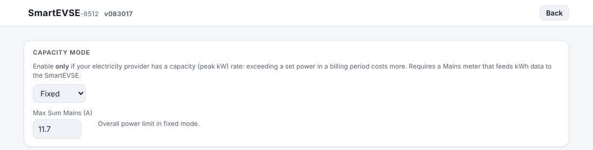
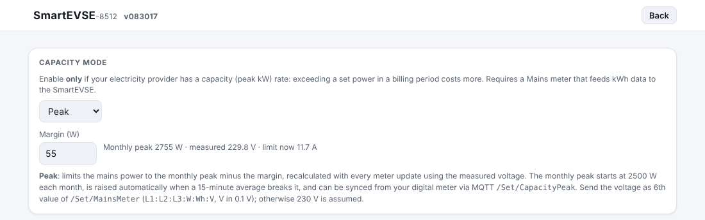

# SmartEVSE-3.5: Clarijs fork, version 4

This fork adds a number of changes to [dingo35/SmartEVSE-3.5](https://github.com/dingo35/SmartEVSE-3.5)
for the **Flemish capacity tariff** (*capaciteitstarief*) and for installations with a
**home battery that does peak shaving**.

- **Base:** `dingo35/SmartEVSE-3.5` master, commit `4c3de7a` (firmware v3.11.3)
- **Firmware branch:** [`release/capacity-peak-build`](https://github.com/Clarijs/SmartEVSE-3.5/tree/release/capacity-peak-build)
- **Tested on:** SmartEVSE v3, single phase, MAINS MET = API (P1 meter via ESPHome/MQTT), EV meter Eastron1P,
  Huawei LUNA2000 home battery, Belgium (Fluvius)

> All changes are backwards compatible: without the new MQTT values and settings the
> firmware behaves like the original v3.11.3.

---

## Contents

1. [Overview](#overview)
2. [Monthly capacity peak](#1-monthly-capacity-peak)
3. [Max Sum Mains in 0.1 A steps](#2-max-sum-mains-in-01-a-steps)
4. [Regulation per switched phase](#3-regulation-per-switched-phase)
5. [Measured mains voltage](#4-measured-mains-voltage)
6. [Capacity mode Peak and configurable margin](#5-capacity-mode-peak-and-configurable-margin)
7. [MQTT and REST reference](#mqtt-and-rest-reference)
8. [Example setup: P1 meter → SmartEVSE](#example-setup-p1-meter--smartevse)
9. [Installing and rolling back](#installing-and-rolling-back)
10. [Branches and pull requests](#branches-and-pull-requests)
11. [Known limitations](#known-limitations)

---

## Overview

| # | Change | Why |
|---|---|---|
| 1 | Monthly capacity peak can be **synced, is published and survives a reboot** | After a reboot the charger reset its peak to 2500 W; the official value from the digital meter could not be used |
| 2 | **Max Sum Mains in 0.1 A** (MQTT, web page, REST) | The regulation already works in 0.1 A, only the limit was whole amps (10 A → 11 A is ±230 W) |
| 3 | Max Sum Mains headroom **per switched phase** instead of always ÷3 | On single phase the charger corrected an overshoot 3× too slowly |
| 4 | **Measured voltage** via the API mains meter | The capacity modes used a fixed 230 V |
| 5 | New capacity mode **Peak** + **configurable margin** | Stable ceiling just under the monthly peak that stays below a home battery's peak-shaving threshold |
| – | Bug fix: negative energy difference could register a bogus peak of up to 65 kW | `uint16_t` overflow in `UpdateCapacity()` |

---

## 1. Monthly capacity peak

In Flanders the bill uses the **highest 15 minute average of the month** (minimum 2.5 kW).
The digital meter reports the official value on its P1 port (OBIS `1-0:1.6.0`).

**What changed**

- New MQTT topic **`<prefix>/Set/CapacityPeak`** (W) and REST parameter **`capacity_peak`**.
  - Only accepted when ≥ 2500 W and when the SmartEVSE knows the date and time.
  - Can only **raise** the peak of the current month, never lower it, exactly like the automatic
    adjustment when a 15 minute average breaks the ceiling. It is a sync, not a static setting.
- The peak is **stored together with its month** (`CapPeakW`, `CapPeakMonth` in preferences):
  - a reboot in the same month keeps the peak,
  - a new month still starts at 2500 W.
- Published on **`<prefix>/CapacityPeak`** (Flanders and Peak mode, with Home Assistant discovery
  as power sensor *Capacity Peak*) and as `capacity_peak_month` in `/settings`.
- Fix: `AveragePower` is now `int32_t` and clamped at 0. A meter reset or replacement can no longer
  wrap around and register a peak of up to 65 kW.

---

## 2. Max Sum Mains in 0.1 A steps

- **`<prefix>/Set/CurrentMaxSumMains`** accepts one decimal: `11.6` (whole amps `11` still work).
  Values set over MQTT are not stored (like before).
- The **Capacity web page** shows and accepts 0.1 A. The REST parameter `current_max_sum_mains`
  accepts one decimal and **stores** the tenths (`MaxSumMainsT`), so a value set in the web interface
  survives a reboot.
- **`<prefix>/MaxSumMains`** is published with one decimal; `/settings` shows
  `current_max_sum_mains_precise`.
- The tenths are dropped as soon as CAPACITY is changed in the LCD menu (which still shows whole amps).



*Capacity page in mode Fixed: Max Sum Mains with one decimal.*

---

## 3. Regulation per switched phase

`CalcBalancedCurrent()` divided the Max Sum Mains headroom **always by 3**. On a single phase setup
the charger therefore reduced only a third of an overshoot per measurement: a kettle switching on
kept the mains above the limit for ±9 seconds (with a measurement every 3 s), long enough to trigger
a home battery's peak shaving.

Now the divisor is the number of phases that is **actually switched**:

| Setup | Divisor |
|---|---|
| Standalone, `CONTACT 2 = Always Off` (1 phase) | **1** (3× faster than before) |
| Standalone, 3 phases or `Auto`/`Solar Off` switched to 3P | 3 (as before) |
| Load balancing (master + nodes) | 3 (as before, conservative) |

Switching between 1P and 3P with a second contactor on **C2** is followed automatically, so the
setup keeps working when you move to three phases later.

---

## 4. Measured mains voltage

**`<prefix>/Set/MainsMeter`** accepts an optional **6th value: voltage L1 in 0.1 V**:

```
L1:L2:L3:W:Wh:V        e.g.  117:0:0:2716:5222464:2324
│  │  │  │ │  └─ voltage L1 in 0.1 V (232.4 V)
│  │  │  │ └──── total import in Wh
│  │  │  └────── mains power in W (+ import / − export)
└──┴──┴───────── current per phase in 0.1 A (signed)
```

- Used when it is **recent (< 60 s)** and **plausible (180–270 V)**; otherwise 230 V as before.
- Used by the capacity modes Interval, Flanders and Peak to convert power to current.
- `/settings` shows `mains_voltage` (last received) and `capacity_voltage` (value used).

Excerpt of `GET /settings` with the new fields (values from this installation):

```json
"settings": {
  "current_max_sum_mains": 11,
  "current_max_sum_mains_precise": 11.7,
  "capacity_mode": 4,
  "capacity_peak_month": 2755,
  "capacity_margin": 55,
  "mains_voltage": 229.8,
  "capacity_voltage": 229.8
}
```
- The normal Smart/Solar regulation works in amps and does not need the voltage.

---

## 5. Capacity mode Peak and configurable margin

### Mode Peak (`CAP MODE = Peak`, value 4)

```
MaxSumMains = (monthly peak − margin) ÷ measured voltage      in 0.1 A, on every meter update
```

- **No 15 minute energy budget** (unlike Flanders): the limit is stable, and the instantaneous
  mains power stays below the threshold of a home battery that does peak shaving.
- Same monthly logic as Flanders: starts at 2500 W each month, is raised automatically when a
  15 minute average breaks it, and can be synced with `/Set/CapacityPeak`.

**Flanders or Peak?**

| | Flanders | Peak |
|---|---|---|
| Controls | 15 minute average (energy budget) | instantaneous power |
| Quiet start of a period | EV may temporarily go above the peak | stays below the peak |
| Last seconds of a period | large swings, possible stop/start | stable |
| Home battery with instantaneous peak shaving | battery feeds the EV when above its threshold | stays below the threshold |
| Average charging power | slightly higher (tens of W) | slightly lower, predictable |

Use **Peak** with a peak-shaving home battery; **Flanders** without one.

### Margin

- **`<prefix>/Set/CapacityMargin`** (W, 0–1000), REST `capacity_margin`, field on the Capacity page.
- Default **100 W** (the former fixed `CapacitySafety`), stored as `CapMargin`.
- Used by Interval, Flanders and Peak. Interval and Flanders now also use the measured voltage and
  0.1 A steps.
- Published on `<prefix>/CapacityMargin`.



*Capacity page in mode Peak: margin field, and a status line with the monthly peak, the measured voltage and the resulting limit (2755 − 55 W) ÷ 229.8 V = 11.7 A.*

Example with a monthly peak of 2755 W, margin 55 W and a home battery shaving at peak − 30 W:

| Voltage | Max Sum Mains | Mains power | Battery threshold |
|---|---|---|---|
| 228 V | 11.8 A | 2690 W | 2725 W |
| 232 V | 11.6 A | 2691 W | 2725 W |
| 236 V | 11.4 A | 2690 W | 2725 W |

---

## MQTT and REST reference

### New or changed MQTT topics

| Topic | Direction | Value |
|---|---|---|
| `<prefix>/Set/MainsMeter` | → EVSE | `L1:L2:L3[:W:Wh[:V]]`, **new optional V in 0.1 V** |
| `<prefix>/Set/CurrentMaxSumMains` | → EVSE | amps, **now with one decimal** (`11.6`) |
| `<prefix>/Set/CapacityPeak` | → EVSE | monthly peak in W (≥ 2500, only raises) |
| `<prefix>/Set/CapacityMargin` | → EVSE | margin in W (0–1000) |
| `<prefix>/MaxSumMains` | EVSE → | amps with one decimal |
| `<prefix>/CapacityPeak` | EVSE → | monthly peak in W (Flanders / Peak) |
| `<prefix>/CapacityMargin` | EVSE → | margin in W |

### New REST parameters (`POST /settings?…`)

| Parameter | Value |
|---|---|
| `current_max_sum_mains` | amps, now with one decimal, stored |
| `capacity_mode` | 0 Disabled, 1 Fixed, 2 Interval, 3 Flanders, **4 Peak** |
| `capacity_peak` | monthly peak in W (only raises) |
| `capacity_margin` | margin in W |

### New fields in `GET /settings` (`settings` object)

`current_max_sum_mains_precise`, `capacity_peak_month`, `capacity_margin`, `mains_voltage`,
`capacity_voltage`.

---

## Example setup: P1 meter → SmartEVSE

The P1 port of the digital meter is read by an ESP8266 with ESPHome. It publishes directly to the
SmartEVSE over MQTT, so Home Assistant is not in the control path (only the MQTT broker is needed).

```
P1 port ──> ESP8266 (ESPHome) ──MQTT──> SmartEVSE (CAP MODE Peak)
                 │
                 └── Home Assistant (API): dashboards, home battery, smart charging
```

ESPHome (excerpt; give the `dsmr` sensors the ids used below):

```yaml
mqtt:
  broker: 192.168.0.129
  username: esphome
  password: !secret mqtt_password
  discovery: false
  topic_prefix: null
  log_topic: null
  birth_message:
  will_message:

interval:
  - interval: 1s            # mains meter for the SmartEVSE, every P1 telegram
    then:
      - if:
          condition:
            lambda: 'return !isnan(id(p_del).state) && !isnan(id(p_ret).state);'
          then:
            - mqtt.publish:
                topic: SmartEVSE-08512/Set/MainsMeter
                payload: !lambda |-
                  float v = id(v_l1).state;
                  if (isnan(v) || v < 180 || v > 270) v = 230.0;
                  float w = (id(p_del).state - id(p_ret).state) * 1000.0;
                  int l1 = (int) lroundf(w / v * 10.0);
                  float e1 = id(e_t1).get_raw_state(), e2 = id(e_t2).get_raw_state();
                  long wh = (isnan(e1) || isnan(e2)) ? -1 : lround((e1 + e2) * 1000.0);
                  char buf[64];
                  snprintf(buf, sizeof(buf), "%d:0:0:%d:%ld:%d",
                           l1, (int) lroundf(w), wh, (int) lroundf(v * 10.0));
                  return std::string(buf);
  - interval: 60s           # official monthly peak (OBIS 1-0:1.6.0)
    then:
      - if:
          condition:
            lambda: 'return !isnan(id(piek_maand).get_raw_state());'
          then:
            - mqtt.publish:
                topic: SmartEVSE-08512/Set/CapacityPeak
                payload: !lambda |-
                  int w = (int) lroundf(id(piek_maand).get_raw_state() * 1000.0);
                  return to_string(w < 2500 ? 2500 : w);
```

SmartEVSE settings: `MAINS MET = API`, `CAP MODE = Peak`, margin via `/Set/CapacityMargin` (e.g. 55).

Home Assistant keeps doing the parts the SmartEVSE cannot do: the home battery's peak shaving
(e.g. Huawei `set_capacity_control_periods` at monthly peak − 30 W), `HomeBatteryCurrent` for Solar
mode, and switching between Pause and Smart for charging in the cheapest quarters.

---

## Installing and rolling back

1. Open the latest successful run of the build on branch
   [`release/capacity-peak-build`](https://github.com/Clarijs/SmartEVSE-3.5/actions) and download the
   artifact **`dists_zip`**.
2. Upload **`firmware.bin`** on the SmartEVSE web page (*Update*). Settings are kept.
   The fork's builds are **not signed** (the signing key is only available to the upstream project),
   which is fine for a manual upload.
3. Set `CAP MODE` and the margin as you like.

**Roll back:** upload `firmware.bin` from the official
[v3.11.3 release](https://github.com/dingo35/SmartEVSE-3.5/releases) in the same way. Unknown
settings (`CapPeakW`, `CapMargin`, `MaxSumMainsT`) are simply ignored. Set `CAP MODE` to a value
0–3 first, because the official firmware does not know mode 4 (Peak).

---

## Branches and pull requests

| Branch | Content | Intended for |
|---|---|---|
| [`capacity-peak`](https://github.com/Clarijs/SmartEVSE-3.5/tree/capacity-peak) | §1 monthly peak (set/raise, publish, persist) + overflow fix | pull request |
| [`maxsummains-tenths`](https://github.com/Clarijs/SmartEVSE-3.5/tree/maxsummains-tenths) | §2 Max Sum Mains in 0.1 A (MQTT, web, REST) | pull request |
| [`maxsummains-phases`](https://github.com/Clarijs/SmartEVSE-3.5/tree/maxsummains-phases) | §3 regulation per switched phase | pull request |
| [`capacity-peak-mode`](https://github.com/Clarijs/SmartEVSE-3.5/tree/capacity-peak-mode) | §1–§5 combined, including measured voltage, mode Peak and margin | pull request (after the others) |
| [`release/capacity-peak-build`](https://github.com/Clarijs/SmartEVSE-3.5/tree/release/capacity-peak-build) | everything + CI change to build without signing key | **firmware for this fork**, not for a PR |

Related discussion upstream: feature requests for a settable monthly peak and for using the measured
voltage instead of `AssumedVoltage = 230`.

---

## Known limitations

- The **LCD menu** shows Max Sum Mains in whole amps; the web page and MQTT show 0.1 A.
- The voltage is only taken from the **API mains meter** (MQTT). Modbus mains meters still use 230 V
  for the capacity modes (the voltage register is defined in `EMConfig[]` but not polled).
- **`HomeBatteryCurrent`** is only used in Solar mode (unchanged).
- The per-phase regulation looks at the contactors, not at the car: a single-phase car on a
  three-phase setup with C2 on is regulated with divisor 3 (the original, slower behaviour).
- Builds from this fork are unsigned and are not offered by the automatic OTA update of the
  official firmware.

---

*Based on [dingo35/SmartEVSE-3.5](https://github.com/dingo35/SmartEVSE-3.5). Changes by
[Clarijs](https://github.com/Clarijs), written with Claude.*
